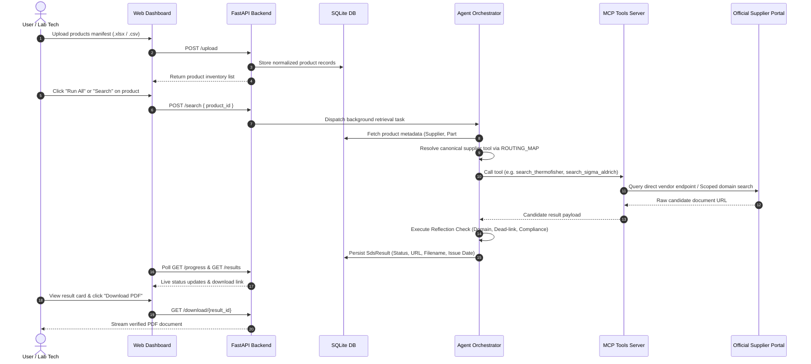
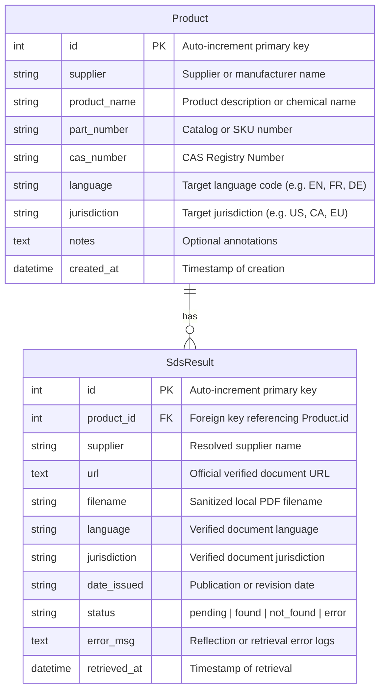

# ⚗️ SDS Retrieval Agent

[](https://www.python.org/)
[](https://fastapi.tiangolo.com/)
[-orange.svg)](https://modelcontextprotocol.io/)
[](https://playwright.dev/)
[](https://sqlite.org/)
[](https://opensource.org/licenses/MIT)

> **Autonomous Multi-Agent Safety Data Sheet (SDS) Retrieval Engine.**  
> Upload chemical manifests in Excel or CSV format and let intelligent, specialized agents automatically discover, verify, validate, and download the latest, compliance-aligned Safety Data Sheets directly from official chemical manufacturer portals.

---

## 📌 Table of Contents

- [Overview](#-overview)
- [Key Features](#-key-features)
- [System Architecture](#-system-architecture)
- [Detailed Retrieval Workflow](#-detailed-retrieval-workflow)
- [Supported Chemical Suppliers](#-supported-chemical-suppliers)
- [Technology Stack](#-technology-stack)
- [Project Structure](#-project-structure)
- [Getting Started](#-getting-started)
  - [Prerequisites](#1-prerequisites)
  - [Installation](#2-installation)
  - [Running the Application](#3-running-the-application)
- [Web Interface Overview](#-web-interface-overview)
- [Input Manifest Specification](#-input-manifest-specification)
- [REST API Reference](#-rest-api-reference)
- [Database Schema](#-database-schema)
- [Evaluation & Reflection Matrix](#-evaluation--reflection-matrix)
- [Troubleshooting & FAQs](#-troubleshooting--faqs)
- [Contributing & License](#-contributing--license)

---

## 🔍 Overview

Managing chemical inventories across laboratories, academic institutions, and manufacturing plants requires up-to-date **Safety Data Sheets (SDS / MSDS)** to satisfy OSHA, WHMIS, REACH, and GHS regulatory requirements. Manually searching across dozens of disparate vendor portals is labor-intensive, error-prone, and susceptible to outdated or broken links.

The **SDS Retrieval Agent** automates this entire lifecycle:
1. Ingests bulk chemical inventories via Excel (`.xlsx`, `.xls`) or CSV files.
2. Normalizes complex chemical supplier names, catalog numbers, and CAS numbers.
3. Dynamically routes queries across a network of **Model Context Protocol (MCP)** tools.
4. Executes targeted multi-tier search strategies against official manufacturer domains and direct vendor APIs.
5. Performs real-time **reflection and verification** (verifying domain authenticity, executing live HTTP status probes, and validating jurisdiction/language compliance).
6. Downloads and caches original PDFs locally while providing an intuitive web interface and analytical metrics.

---

## ✨ Key Features

- **⚡ Zero-Latency Multi-Agent Tool Routing**: Direct canonical supplier resolution matches over 70+ brand names and variants to dedicated scrapers and API adapters without stalling in recursive LLM loops.
- **🛡️ Authentic Official Sourcing**: Documents are fetched strictly from verified manufacturer domains (e.g., `fishersci.com`, `sigmaaldrich.com`, `avantorsciences.com`, `henkel.com`, `3m.com`). Third-party aggregators and unverified sources are rejected by design.
- **🔍 Multi-Tiered Search Engine**:
  - Direct manufacturer endpoint queries using exact catalog/part numbers.
  - Domain-scoped web scraping with intelligent query expansion.
  - Unwrapping of complex redirected URLs and base64 payloads.
  - Negative token filtering to strip out brochures, Technical Data Sheets (TDS), certificates of analysis (CoA), and product flyers.
- **🔬 Reflection & Verification Matrix**:
  - **Domain Whitelist Validation**: Ensures URLs originate from verified manufacturer networks.
  - **Live HTTP Status Probes**: Sends `HEAD`/`GET` requests to ensure zero 404 dead links.
  - **Regulatory Alignment**: Confirms compliance with requested language (English, French, German, Spanish, Chinese, Japanese, etc.) and jurisdiction (US, Canada/WHMIS, EU/REACH, GHS, etc.).
- **📊 Real-Time Evaluation Dashboard**: Live metrics tracking retrieval success rate, total processed items, and granular precision breakdown per supplier and jurisdiction.
- **📂 Resilient Multi-Engine File Parser**: Parses Excel and CSV files regardless of character encoding (`utf-8`, `utf-8-sig`, `latin1`, `cp1252`), delimiters (`,`, `;`, `\t`, `|`), or formatting anomalies.
- **🖥️ Modern Single-Page Application (SPA)**: Clean, responsive user interface featuring drag-and-drop uploads, interactive product data tables, inline editing modal, and real-time task status tracking.

---

## 🏗️ System Architecture

```
                          ┌────────────────────────┐
                          │   Client Web Browser   │
                          │   (HTML5, CSS3, JS)    │
                          └───────────┬────────────┘
                                      │ HTTP / REST & Static Assets
                                      ▼
                          ┌────────────────────────┐
                          │    FastAPI Backend     │
                          │        (api.py)        │
                          └───────────┬────────────┘
                                      │
            ┌─────────────────────────┼─────────────────────────┐
            ▼                         ▼                         ▼
   ┌─────────────────┐       ┌─────────────────┐       ┌─────────────────┐
   │ SQLite Database │       │  Downloads Dir  │       │  Orchestrator   │
   │  (sds_agent.db) │       │ (Local PDF Hub) │       │   Agent Engine  │
   │     (db.py)     │       └─────────────────┘       │(orchestrator.py)│
   └─────────────────┘                                 └────────┬────────┘
                                                                │ Async Subprocess / JSON-RPC
                                                                ▼
                                                       ┌─────────────────┐
                                                       │ MCP Client Hub  │
                                                       │ (mcp_client.py) │
                                                       └────────┬────────┘
                                                                │ FastMCP Tool Invocations
                                                                ▼
                                                       ┌─────────────────┐
                                                       │ FastMCP Server  │
                                                       │  (server_sds.py)│
                                                       └────────┬────────┘
                                                                │
                 ┌──────────────────────────────────────────────┴──────────────────────────────┐
                 ▼                                              ▼                              ▼
      [Direct Vendor Endpoints]                     [Scoped Domain Scrapers]         [DuckDuckGo & Bing Fallback]
   FisherSci MSDS, Sigma API, etc.                3M, Henkel, Avantor, TCI, etc.    Strict Supplier Domain Filter
```

---

## 🔄 Detailed Retrieval Workflow



---

## 🏢 Supported Chemical Suppliers

The system includes pre-configured scrapers and canonical routing resolvers for over 70+ suppliers, brands, and parent organizations:

| Category | Supported Suppliers & Aliases | Primary Domains Scoped |
|---|---|---|
| **Life Sciences & Laboratory** | **ThermoFisher Scientific**, Fisher Scientific, Alfa Aesar, Acros Organics, Oxoid, Remel | `fishersci.com`, `thermofisher.com`, `alfa.com`, `acros.com` |
| | **Sigma-Aldrich**, Merck KGaA, MilliporeSigma, EMD Millipore, EMD Chemicals, EM Science | `sigmaaldrich.com`, `merckmillipore.com`, `milliporesigma.com` |
| | **Avantor**, VWR International, JT Baker, Macron Fine Chemicals | `vwr.com`, `avantorsciences.com`, `jtbaker.com` |
| | **TCI Chemicals** (Tokyo Chemical Industry), TCI America | `tcichemicals.com`, `tci-america.com` |
| | **Enamine**, EnamineStore | `enamine.net`, `enaminestore.com` |
| | **BLD Pharmatech**, BLD Pharm | `bldpharm.com` |
| | **Pharmablock** | `pharmablock.com` |
| **Industrial & Polymers** | **3M**, 3M Canada, Imation | `3m.com`, `3m.ca`, `multimedia.3m.com` |
| | **Henkel**, Loctite, Fel-Pro, Henkel Adhesives | `henkel.com`, `sds.henkel.com`, `loctite.com` |
| | **Honeywell**, AlliedSignal, Honeywell Performance Materials | `lab-honeywell.com`, `honeywell.com` |
| | **Hach Company**, Hach Co. | `hach.com` |
| | **ITW ProBrands**, Devcon, Plexus, LPS Laboratories, Dykem | `itwprobrands.com`, `itwpolymers.com`, `devcon.com` |
| | **ExxonMobil**, Mobil, Imperial Oil, Esso | `exxonmobil.com`, `mobil.com`, `imperialoil.ca` |
| | **CRC Industries** | `crcindustries.com` |
| | **GOJO Industries**, Purell, Provon | `gojo.com`, `purell.com` |
| | **Momentive Performance Materials**, GE Silicones | `momentive.com` |
| | **Kleen-Flo Tumbler** | `kleenflo.com` |
| | **MG Chemicals** | `mgchemicals.com` |
| | **Lubriplate Lubricants** | `lubriplate.com` |
| | **Solvay**, Syensqo | `solvay.com` |
| | **DuPont**, Dow, BASF, Evonik, Air Liquide / Airgas | `dupont.com`, `dow.com`, `basf.com`, `evonik.com`, `airgas.com` |
| **Universal Fallback** | Any unlisted supplier via `search_generic` tool | Scoped dynamically to verified domain matching input |

---

## 💻 Technology Stack

- **Backend Framework**: [FastAPI](https://fastapi.tiangolo.com/) with [Uvicorn](https://www.uvicorn.org/) ASGI engine.
- **Agent Architecture**: [FastMCP](https://github.com/jlowin/fastmcp) (Model Context Protocol) subprocess communication.
- **Web Automation & Scraping**:
  - [Playwright Chromium](https://playwright.dev/python/) for complex JavaScript single-page applications.
  - [Requests](https://requests.readthedocs.io/) & [BeautifulSoup4](https://www.crummy.com/software/BeautifulSoup/) for fast HTTP and DOM extraction.
- **Data Persistence & Modeling**:
  - [SQLAlchemy 2.0](https://www.sqlalchemy.org/) ORM with [SQLite 3](https://sqlite.org/).
  - [Pandas](https://pandas.pydata.org/) & [OpenPyXL](https://openpyxl.readthedocs.io/) for high-throughput spreadsheet parsing.
- **Frontend Architecture**:
  - Clean HTML5 & Vanilla CSS3 design system with custom CSS variables, dark/light surface gradients, and glassmorphism.
  - Native asynchronous JavaScript (Fetch API, responsive DOM manipulation, zero heavy frontend build steps).

---

## 📁 Project Structure

```
SDS Retrieval Agent/
├── agent_orchestrator.py   # Multi-agent dispatch, routing table, and reflection matrix
├── api.py                  # FastAPI REST API, SSE/polling handlers, file upload engine
├── db.py                   # SQLAlchemy ORM models (Product, SdsResult) and DB helpers
├── mcp_client.py           # Subprocess JSON-RPC FastMCP client wrapper
├── server_sds.py           # FastMCP server exposing supplier-specific scraper tools
├── requirements.txt        # Python dependency manifest
├── start.bat               # Windows one-click startup and browser verification script
├── sds_agent.db            # SQLite database (auto-generated at runtime)
├── .gitignore              # Git ignore rules for virtualenvs, caches, and DBs
├── README.md               # Complete project documentation
├── downloads/              # Local storage cache for downloaded SDS PDF files
│   └── .gitkeep
└── frontend/               # Single-Page Application web assets
    ├── index.html          # Semantic HTML structure & multi-tab navigation
    ├── style.css           # Premium responsive styling and modern design system
    └── app.js              # Client-side state management, polling, and UI interactions
```

---

## 🚀 Getting Started

### 1. Prerequisites

- **Python 3.10 or higher** installed ([python.org](https://www.python.org/downloads/)).
- **Git** installed on your system.
- *(Optional)* [Ollama](https://ollama.com) if you wish to run local LLM evaluations:
  ```bash
  ollama pull mistral:7b
  ```

### 2. Installation

1. **Clone the repository**:
   ```bash
   git clone https://github.com/PS-Bhavya-B/sds-retrieval-agent.git
   cd sds-retrieval-agent
   ```

2. **Create and activate a virtual environment**:
   ```bash
   # Windows (PowerShell)
   python -m venv .venv
   .venv\Scripts\Activate.ps1

   # Linux / macOS
   python3 -m venv .venv
   source .venv/bin/activate
   ```

3. **Install dependencies**:
   ```bash
   pip install --upgrade pip
   pip install -r requirements.txt
   ```

4. **Install Playwright browser binaries**:
   ```bash
   playwright install chromium
   ```

---

### 3. Running the Application

#### Option A: One-Click Launch (Windows)
Double-click `start.bat` or run it from PowerShell:
```powershell
.\start.bat
```
This script automatically checks for Playwright Chromium binaries, installs them if missing, and starts Uvicorn with hot-reload enabled.

#### Option B: Manual Command Line
```bash
uvicorn api:app --host 127.0.0.1 --port 8000 --reload
```

Once running, access the services:
- **Interactive Web App**: [http://127.0.0.1:8000/app](http://127.0.0.1:8000/app)
- **Interactive Swagger API Docs**: [http://127.0.0.1:8000/docs](http://127.0.0.1:8000/docs)
- **Alternative ReDoc API Docs**: [http://127.0.0.1:8000/redoc](http://127.0.0.1:8000/redoc)

---

## 🖥️ Web Interface Overview

The SPA interface is divided into four dedicated tabs:

1. **📁 Upload Tab**:
   - Visual drag-and-drop zone supporting `.xlsx`, `.xls`, and `.csv`.
   - Download sample template button (`/template`).
   - Visual catalog of supported chemical suppliers with quick-reference tags.
2. **📋 Products Tab**:
   - Comprehensive inventory data table showing Product Name, Supplier, Part #, CAS #, Language, Jurisdiction, and status.
   - Real-time search filter for quick lookup.
   - **Run All** button to batch process all queued items.
   - Individual **Search** button per product row.
   - **Edit** modal button to update part numbers, target language, or jurisdiction before re-running.
   - **Delete** row or **Clear All** inventory.
3. **📄 SDS Results Tab**:
   - Interactive card grid presenting retrieved documents.
   - Status indicators (`Found`, `Not Found`, `Error`).
   - One-click **Download PDF** button (retrieves file directly from backend cache).
   - Direct link to supplier web portal source.
   - Error messages and reflection audit logs for failed retrievals.
4. **📊 Evaluation Metrics Tab**:
   - High-level KPI summary cards: Retrieval Success Rate (%), Total Processed, Verified Found, and Errors.
   - Granular breakdown table detailing precision rates per chemical supplier.

---

## 📋 Input Manifest Specification

You can upload your own custom inventory spreadsheets. The file parser automatically detects column headers regardless of casing, punctuation, or variations:

| Standard Header | Supported Header Aliases | Example Value | Description |
|---|---|---|---|
| **Supplier** | `Vendor`, `Manufacturer`, `Company` | `ThermoFisher` | Name of the chemical supplier |
| **Product Name** | `Product`, `Chemical`, `Description`, `Item` | `Acetonitrile HPLC Grade` | Chemical or product name |
| **Part Number** | `Part #`, `PartNo`, `Catalog #`, `Cat #`, `SKU` | `A/0626/17` | Manufacturer catalog / item number |
| **CAS Number** | `CAS #`, `CAS RN`, `Registry Number` | `75-05-8` | Chemical Abstracts Service registry number |
| **Language** | `Lang`, `Document Language` | `EN` | Desired SDS language (e.g., `EN`, `FR`, `DE`, `ES`) |
| **Jurisdiction** | `Region`, `Country`, `Regulatory` | `US` | Compliance region (e.g., `US`, `CA`, `EU`, `GHS`) |
| **Notes** | `Comments`, `Internal Ref` | `Lab Stock B-2` | Optional internal reference notes |

> **Tip**: You can download a ready-to-use template directly from the application UI or by navigating to `http://127.0.0.1:8000/template`.

---

## 📡 REST API Reference

### Health & System
| Method | Endpoint | Description |
|---|---|---|
| `GET` | `/` | API root check and welcome status |
| `GET` | `/health` | Service health status check (`{"status": "ok"}`) |

### Products Management
| Method | Endpoint | Description |
|---|---|---|
| `POST` | `/upload` | Upload `.xlsx`, `.xls`, or `.csv` file with multipart form data |
| `GET` | `/products` | List all chemical products stored in the database |
| `GET` | `/products/{product_id}` | Retrieve single product details by ID |
| `PATCH` | `/products/{product_id}` | Update product fields (supplier, part #, language, jurisdiction) |
| `DELETE` | `/products/{product_id}` | Delete a single product and associated SDS results |
| `DELETE` | `/products` | Clear entire database (products and results) |
| `GET` | `/template` | Stream and download pre-formatted Excel template |

### SDS Retrieval & Tasks
| Method | Endpoint | Description |
|---|---|---|
| `POST` | `/search` | Trigger background retrieval for a single product (`product_id`) or all products |
| `POST` | `/search/sync/{product_id}` | Synchronous blocking retrieval (returns result immediately) |
| `GET` | `/results` | List all retrieved SDS records (filterable by `product_id`) |
| `GET` | `/progress` | Get active execution status and progress logs for all tasks |
| `GET` | `/progress/{product_id}` | Get status message for a specific product ID |

### Downloads & Metrics
| Method | Endpoint | Description |
|---|---|---|
| `GET` | `/download/{result_id}` | Download local or on-the-fly cached SDS PDF document |
| `GET` | `/download/url/{result_id}` | Retrieve official external source URL |
| `GET` | `/metrics` | Compute real-time evaluation analytics and supplier breakdown |

---

## 🗄️ Database Schema

The database utilizes SQLite with SQLAlchemy 2.0 relational models:



---

## 🛡️ Evaluation & Reflection Matrix

To ensure compliance integrity and prevent hallucinations, every retrieved candidate document passes through a multi-dimensional reflection audit before being saved:

1. **Schema & Link Precision**: Confirms valid HTTP/HTTPS formatting and ensures the URL is not empty.
2. **Official Domain Whitelist Check**: Cross-references the destination hostname with authorized domain lists (e.g., verifying that a Fisher Scientific result comes strictly from `fishersci.com` or `assets.fishersci.com`).
3. **Zero-Dead-Link Policy**: Executes a lightweight live HTTP probe (`HEAD` with fallback to streaming `GET`). Any candidate returning HTTP 404 or 410 is immediately flagged and rejected.
4. **Regulatory & Compliance Alignment**: Verifies that the language and regulatory jurisdiction match the requester's requirements.

---

## ❓ Troubleshooting & FAQs

### 1. Why did a specific product return "Not Found"?
- Ensure the **Part Number** or **Catalog Number** is provided and accurate. Suppliers often have multiple revisions or grades of the same chemical.
- Verify that the **Supplier** name matches the actual manufacturer (e.g., specifying `ThermoFisher` for Acros or Alfa Aesar products).
- Check the **Jurisdiction** and **Language**. Some regional portals restrict access if the product is not distributed in that market.

### 2. Can I run the agent behind an enterprise proxy?
Yes. Set standard environment variables in your terminal:
```bash
set HTTP_PROXY=http://proxy.yourcompany.com:8080
set HTTPS_PROXY=http://proxy.yourcompany.com:8080
```

### 3. Does the system store confidential inventory data in the cloud?
No. All data, SQLite records, and downloaded PDFs are stored **100% locally** on your machine in the project root (`sds_agent.db` and the `downloads/` directory).

---

## 📄 Contributing & License

Contributions, issues, and feature requests are welcome! Feel free to open an issue or submit a pull request.

Distributed under the **MIT License**. See `LICENSE` for more information.
